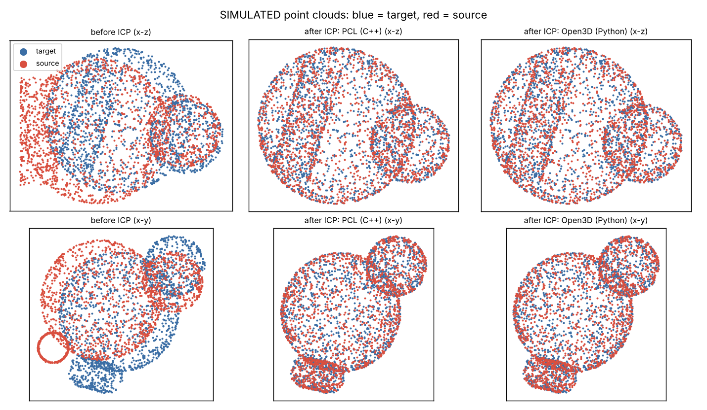
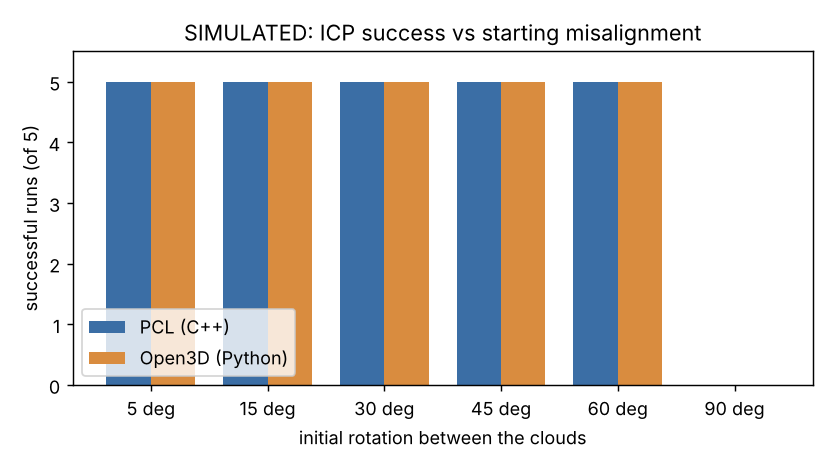

# PCL_Point-Cloud-Library_Cpp_QT

点云配准 (point cloud registration) with the **Point Cloud Library (PCL)** in **C++** and **Open3D** in **Python**. Two clouds of the same object start in different poses; point-to-point **ICP** (iterative closest point) finds the rigid transform that aligns them, and the result is checked against the known true transform.

> **All data here is SIMULATED.** Research and learning code, not validated for clinical use. To use it for other purposes, contact me: owaiskhan_bangash@yahoo.com



## Result (demo: 30 degree rotation + shift, 3500 points per cloud)

| | PCL (C++) | Open3D (Python) |
|---|---|---|
| Nearest-neighbour RMSE before ICP | 0.2476 | 0.2476 |
| Nearest-neighbour RMSE after ICP | 0.0400 | 0.0400 |
| Rotation error | 1.404 deg | 1.411 deg |
| Translation error | 0.0021 | 0.0021 |

The two implementations agree to 0.01 deg (PCL works in 32-bit floats, Open3D in 64-bit). The remaining 1.4 deg is because the two clouds are **independent random samples** of the surface, so no point has an exact partner.

## How far apart can the clouds start?



5 random seeds per angle, success = rotation error below 5 deg (`results/experiments.txt`):

| Start rotation | 5 | 15 | 30 | 45 | 60 | 90 |
|---|---|---|---|---|---|---|
| PCL, successful runs | 5/5 | 5/5 | 5/5 | 5/5 | 5/5 | **0/5** |
| Open3D, successful runs | 5/5 | 5/5 | 5/5 | 5/5 | 5/5 | **0/5** |

ICP works up to about 60 deg here and fails at 90 deg: it only finds the **nearest** match, so it needs a rough starting alignment. Real data usually needs a coarse step first (for example feature matching or RANSAC).

## Run

```bash
# data (writes data/source.ply, data/target.ply, data/gt.txt)
python3 python/make_data.py --out data --angle 30 --seed 1

# C++ with PCL (needs PCL 1.8+, CMake)
cmake -S . -B build && cmake --build build
./build/icp_registration --data data --out results --tag cpp

# Python with Open3D
pip install numpy scipy open3d matplotlib
python3 python/icp_registration.py --data data --out results --tag python

python3 tools/plot_results.py        # figure
python3 tools/run_experiments.py     # angle experiment
```

## Honest limits

- Simulated object (two spheres and a cylinder) with clean noise, one scale, no outliers or partial overlap.
- Point-to-point ICP only. Settings: max match distance 0.5, 100 iterations.
- The 5 deg success threshold and 5 seeds are my choices; real scans behave differently.

## Files

- `cpp/icp_registration.cpp`: PCL ICP and error measurement
- `python/make_data.py`, `python/icp_registration.py`: data generator and Open3D version
- `tools/`: figures and experiments
- `PCL-PointCloudLibrary.cpp`: my 2022 example of reading and writing PLY and PCD files (Windows paths, edit them before use)

Download PCL: https://pointclouds.org/downloads/

## License

MIT, see `LICENSE`.
